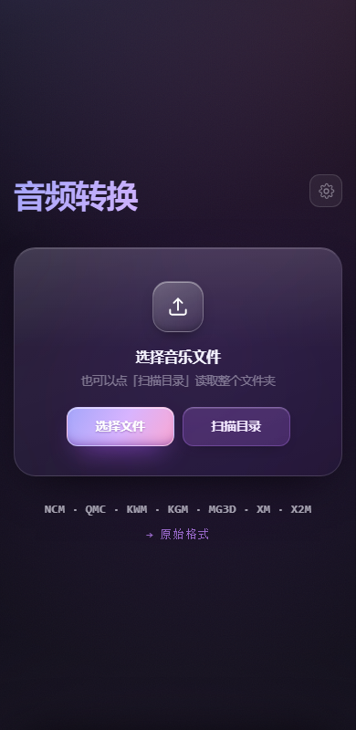
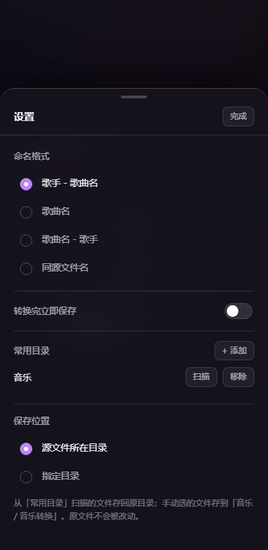

# 音乐转换 convert-music

在浏览器或手机上，把已购的加密音乐文件还原成标准 **MP3 / FLAC / OGG / M4A / WAV**。

**全程本地处理，文件不上传、不联网、不留痕。**

<p align="center">
  
  &nbsp;&nbsp;
  
</p>

---

## 支持格式

一个入口，全部自动识别 —— 不需要手动选择「我要转哪种」。

| 平台 | 后缀 | 说明 |
| --- | --- | --- |
| **网易云音乐** | `.ncm` | 完整支持 |
| **QQ 音乐** | `.qmc0` `.qmc2` `.qmc3` `.qmc4` `.qmc6` `.qmc8`<br>`.qmcflac` `.qmcogg` `.mflac` `.mflac0`<br>`.mgg` `.mgg0` `.mgg1` `.mggl` `.tkm` | 支持 Static / Map / RC4 三种加密，含 EncV2 密钥 |
| **酷我音乐** | `.kwm` | 完整支持 |
| **酷狗音乐** | `.kgm` `.kgma` | 完整支持，单文件上限 **32MB** |
| **咪咕音乐** | `.mg3d` | 完整支持 |
| **虾米音乐** | `.xm` | 支持 WAV / FLAC / MP3 / M4A |
| **喜马拉雅** | `.x2m` `.x3m` | 完整支持 |
| JOOX | `.ofl_en` | **不支持**（依赖的库已从 npm 下架，无替代实现） |

> 酷狗格式需要一张 70MB 的密钥表。这里截取前 2MB 内联进页面（gzip 后约 340KB），因此单文件上限为 32MB —— 足够覆盖普通无损单曲。超出会明确提示，不会生成坏文件。

## 功能

- **自动识别**：看扩展名 + 文件头双重校验，认不出的直接拒绝，不会解出乱码
- **批量转换**：一次拖入多个文件，逐首处理并显示进度
- **命名格式**：歌手-歌曲名 / 歌曲名 / 歌曲名-歌手 / 同源文件名，选择会记住
- **转换完立即保存**：打开后转完自动落盘，手机上省一步
- **保存位置**：可设为「源文件所在目录」或「指定目录」，源文件永不被改动
- **扫描目录**：记住音乐文件夹，下次点一下就读取整个文件夹（桌面 Chrome/Edge 与 APK）
- **单条下载**：结果列表里每首都能单独保存，也可以整批保存

## 两个入口

首页只有两个动作，不做多余的分层：

| 按钮 | 作用 |
| --- | --- |
| **选择文件** | 挑一个或多个文件 |
| **扫描目录** | 读取整个文件夹（可递归子目录） |

「扫描目录」会记住你选过的文件夹：

- **第一次点** —— 弹出系统文件夹选择器，选完**自动开始扫描**，不用再点一次
- **以后点** —— 直接扫，不再询问

手机上会自动隐藏「扫描目录」里的文件夹选择能力差异，只保留可用的那部分；如果系统完全不支持目录访问（如部分手机浏览器），该按钮会隐藏。

## 使用方式

### 网页版

```
https://knownothing20.github.io/convert-music/
```

拖入文件即可。桌面端还支持直接拖文件夹。

本地运行需要 http 协议（PWA 与 Service Worker 限制），不能双击打开：

```bash
python -m http.server 8080
# 访问 http://localhost:8080
```

### Android

```
https://github.com/knownothing20/convert-music/releases/latest/download/convert-music.apk
```

- WebView 壳工程，与网页共用同一份 `index.html`
- debug 签名，安装需允许「未知来源」
- 最低 Android 10（API 29）
- 转换结果默认存入「音乐 / 音乐转换」；从常用目录扫描的文件会存回原目录
- WebView 不支持 `blob:` 下载，页面检测到原生桥接后改用分块传输写盘

## 关于保存位置

| 文件来源 | 保存到 |
| --- | --- |
| 用「扫描目录」读入 | 原目录（手机上需重新添加一次目录以获取写权限） |
| 手动拖入 / 选择 | 手机：「音乐 / 音乐转换」<br>电脑：浏览器下载目录 |
| 设置里指定了目录 | 一律存到指定目录 |

**源文件永远不会被覆盖。** 输出文件扩展名不同（`.ncm` → `.flac`），物理上是新文件；同名时自动加序号。

## 部署

1. 仓库 **Settings → Pages**
2. **Source** 选择 **GitHub Actions**
3. 推送 `main` 自动构建，工作流见 `.github/workflows/static.yml`

## 实现说明

解密逻辑都是按公开算法自行实现的纯 JavaScript，**没有引入任何 WASM 或第三方解密库**：

- **酷狗**：两个掩码流异或，公钥流来自内联的密钥表（运行时用原生 `DecompressionStream` 解压）
- **QQ 音乐**：TEA 派生密钥 + Static / Map / RC4 三种流密码
- **网易云**：AES-ECB + RC4 双重解密，元数据单独解密
- **酷我 / 虾米 / 咪咕 / 喜马拉雅**：定长头部 + 掩码运算

隐私方面，页面**没有任何对外请求**：不含统计脚本、不上报使用数据、不查询歌曲信息。原版 unlock-music 会向 `um-api.ixarea.com` 发送版本号与歌曲元信息，这部分已全部移除。

## 相对原版的改动

- **移除全部在线查询**：版本检查、封面查询、曲目信息查询改为本地空实现
- **移除 WASM 加速模块**：源码包未附带编译产物，改用等价的纯 JavaScript 实现（结果一致，性能略低）
- **移除统计上报**：原版向 `stats.ixarea.com` 发送数据，已阻断
- **自行实现酷狗解密**：原作者依赖的 npm 包已下架，按其公开算法重写并内置密钥表
- 界面重做：移动端优先的深色玻璃拟态，支持 PWA 安装
- 首页与经典版（`/classic/`）共用同一份静态资源，后者为 unlock-music v1.10.3 构建产物，保留作为备用入口

## 使用须知

- 解密全部在本地进行，不联网、不上传
- 浏览器沙箱无法删除你磁盘上的原始文件，转换完成后需自行清理
- 仅供个人已购内容的格式迁移，请遵守各平台服务条款与著作权法律法规

## 许可

MIT License，见 [LICENSE](LICENSE)。

本项目基于开源项目 [unlock-music](https://git.unlock-music.dev/um/web)，原始版权归其作者所有，按 MIT 许可保留原版权声明。
